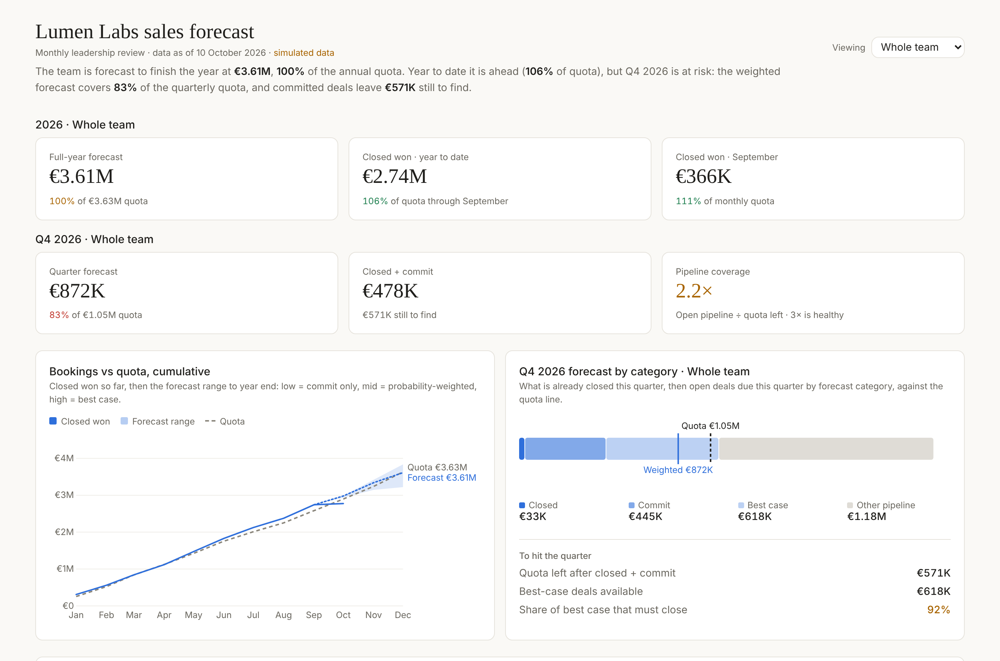
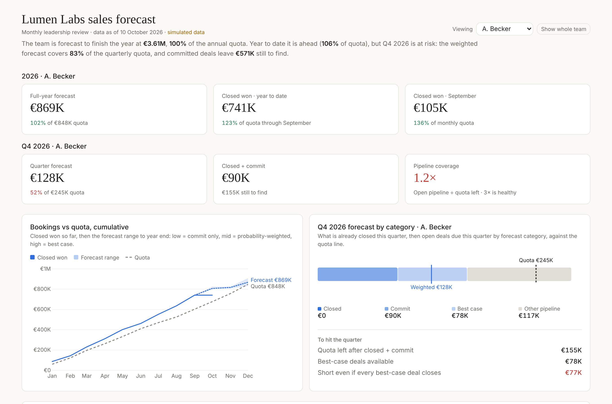
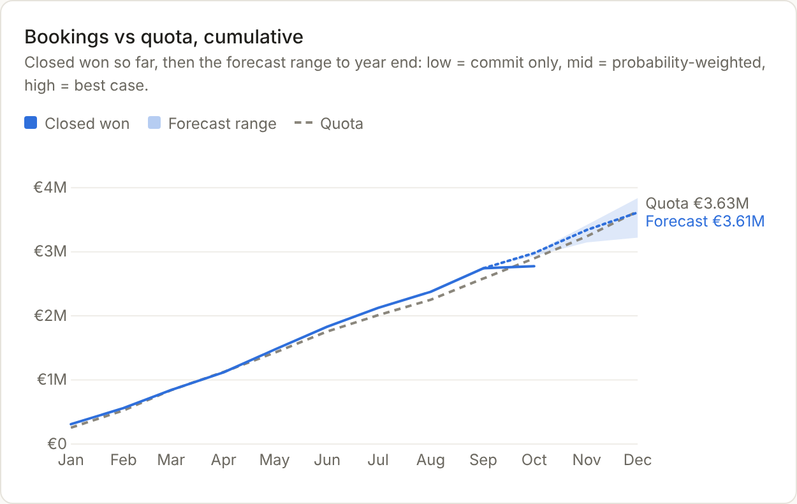
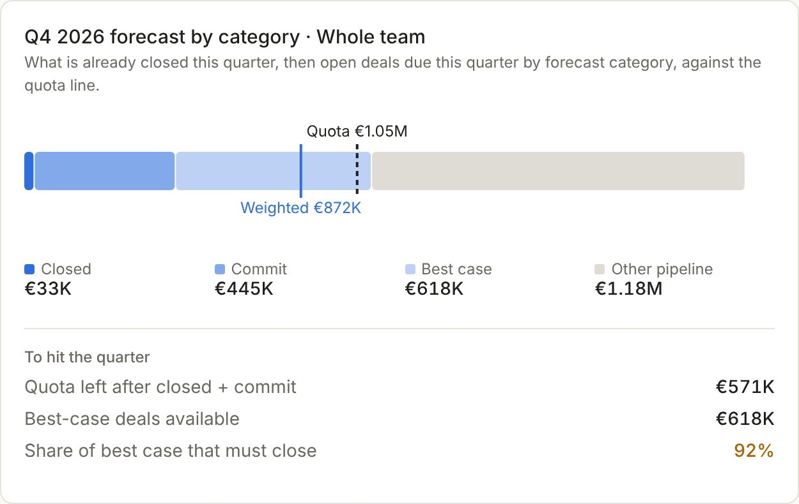
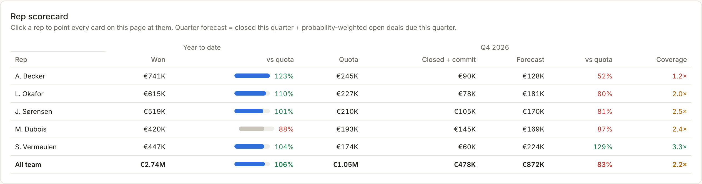
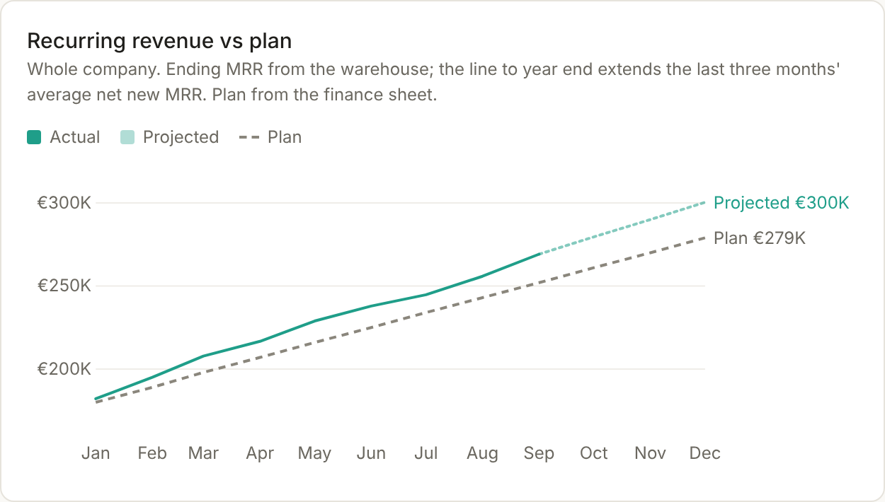
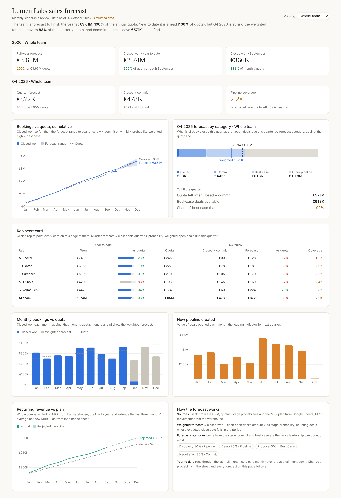
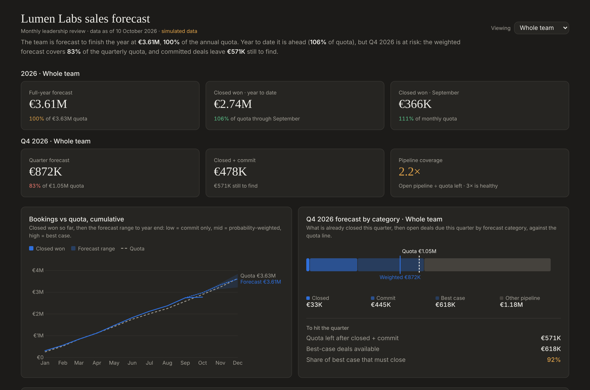
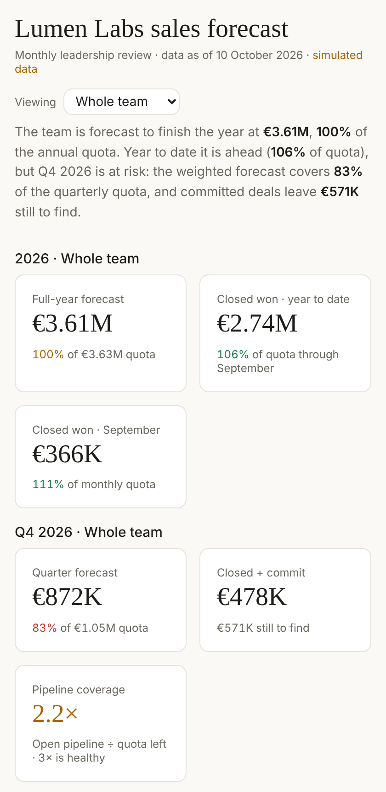
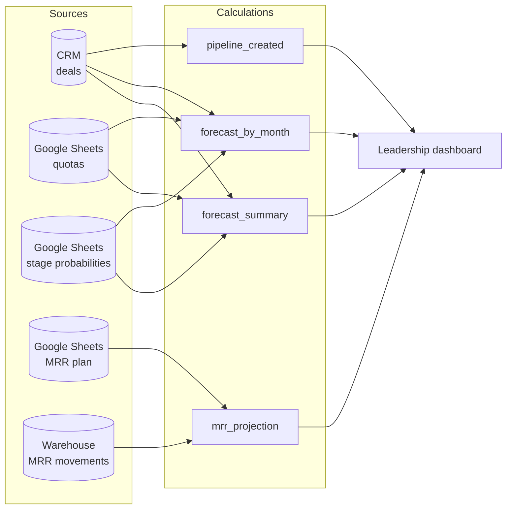

# Sales Forecast Dashboard

**One monthly view for leadership that combines the CRM, Google Sheets plans and the data warehouse into a single, traceable sales forecast.**

Built as a [Claude Dashboard](https://claude.ai): every number on the page is computed from named source datasets, and clicking a number shows exactly which system, rows and formula produced it. This repository holds the dashboard's source, the (simulated) source data, and a local preview so anyone can run it.



> **The data is simulated.** "Lumen Labs" is a fictional B2B SaaS company. The numbers are generated by [`scripts/generate_data.py`](scripts/generate_data.py) to behave like a real sales team, as of 10 October 2026.

---

## Why put every data source in one dashboard?

A SaaS company's numbers do not live in one place. Deals and pipeline sit in the **CRM**. Quotas, forecast assumptions and the financial plan sit in **spreadsheets** owned by sales ops and finance. Recurring revenue, churn and expansion come from billing and the product database, modelled in the **data warehouse**. Each system is accurate about its own piece, and **none of them can answer the questions leadership actually asks.**

### The decisive numbers only exist in the join

| Question leadership asks | What it takes to answer it |
|---|---|
| Will we hit the annual target? | Closed and open deals (CRM) + quota plan (Sheets) + stage probabilities (Sheets) |
| Is this quarter at risk, and by how much? | Open deals by expected close date (CRM) + quarterly quota (Sheets) + forecast categories (Sheets) |
| Which rep needs help *now*? | Each rep's pipeline (CRM) measured against each rep's quota (Sheets) |
| Is recurring revenue on plan? | MRR movements (warehouse) + finance plan (Sheets) |
| Will next quarter be healthy? | Pipeline creation by month (CRM) set against forward quota (Sheets) |

Look at any one system alone and you get a fragment: a pipeline total with no target, a quota with no pipeline, an MRR line with no plan. The insight is in the *ratio* between systems: attainment, coverage, gap to plan. That ratio can only be computed once the sources sit side by side.

### What changes when they are combined

**1. One version of the truth.** Without a unified view, the monthly review usually starts with reconciling exports: the CRM says one number, the finance sheet another, the board deck a third. When every figure is calculated from the same named sources with visible formulas, the meeting moves from "whose number is right?" to "what do we do about it?".

**2. Risks surface earlier.** This demo contains a typical example. A. Becker is the top performer year to date (**123% of quota**). A CRM-only leaderboard would rank them first and move on. Join the CRM to the quota sheet for the *current quarter*, though, and the same rep has **1.2× pipeline coverage** and a **52% quarter forecast**: the strongest year and the weakest quarter on the team. That is a coaching or territory conversation for October, not a surprise in January.



**3. A forecast instead of a rear-view mirror.** Closed revenue tells you where you have been. Weighting open deals by stage probability (kept in a sheet that RevOps owns) turns the CRM into a forward-looking range: commit, weighted and best case, against quota. When leadership changes an assumption in the sheet, every forecast on the page follows.

**4. Faster, better strategic decisions.** With the full picture in one place, the monthly review can make the calls that matter:
- **Revenue guidance.** The team is forecast to land the year at €3.61M, right at quota (99.5%), but Q4 alone is forecast at 83%. Guidance to the board should reflect the quarter risk, not just the healthy year-to-date figure.
- **Where to push this quarter.** Closed + commit leaves €571K to find. That requires 92% of all best-case deals to close, which is not a plan. Leadership can see it and act (deal reviews, executive sponsorship, pulling forward Q1 deals).
- **Hiring and territory.** Reps with high attainment but thin coverage need pipeline. Reps with low attainment and high coverage need help closing. Each calls for a different fix.
- **Marketing and pipeline investment.** New pipeline created per month is the leading indicator for next quarter. A drop shows up here months before it shows up in bookings.
- **Plan vs. reality on recurring revenue.** MRR is tracking above the finance plan, which gives room to invest. A CRM-only view would never show this.

**5. Trust through traceability.** Every figure is marked with its source. In the live dashboard, clicking a number opens its provenance: the dataset, the matching row, and for joined figures the formula and which systems fed it. Numbers that can be checked get used. Numbers that cannot get second-guessed.

---

## What leadership sees each month

| | |
|---|---|
| **Cumulative bookings vs quota.** Closed won so far, then the forecast range to year end: commit (low), probability-weighted (mid), best case (high).  | **Quarter forecast by category.** What is already closed, then open deals due this quarter by category against the quota line, and what it takes to close the gap.  |
| **Rep scorecard.** Year-to-date attainment next to this quarter's quota, forecast and coverage. Click a rep to point the whole page at them.  | **Recurring revenue vs plan.** Warehouse MRR against the finance plan, projected to year end at the recent net-new run rate.  |

<details>
<summary>Full page, dark mode and mobile</summary>





</details>

### A monthly review in five questions
1. **Are we on track for the year?** Full-year forecast vs annual quota.
2. **Did last month land?** Closed won vs last month's quota.
3. **Is this quarter safe?** Closed + commit vs quarterly quota, and the share of best case that must close.
4. **Who needs help?** Reps whose quarter forecast is below 90% or whose coverage is below 2×.
5. **Is the future healthy?** New pipeline created, and MRR against plan.

---

## How it works



### Forecast method
- **Weighted forecast** = closed won + Σ (open deal amount × stage probability), for deals whose expected close date falls in the period.
- **Forecast categories** come from the deal stage: *Negotiation* → Commit (80%), *Proposal* → Best case (50%), *Demo* (25%) and *Discovery* (10%) → Pipeline. The probabilities live in [`data/sheets_stage_probabilities.csv`](data/sheets_stage_probabilities.csv) so the business, not the code, owns them.
- **Pipeline coverage** = open pipeline due this quarter ÷ quota still to close this quarter. Around 3× is usually considered healthy.
- **Year to date** runs through the last full month, so a part-month never drags attainment down.
- **MRR projection** extends the last three months' average net new MRR to year end.

[`scripts/check_forecast.py`](scripts/check_forecast.py) recomputes the headline figures independently in Python, as a cross-check of the dashboard's calculations.

---

## Repository layout

```
├── dashboard/
│   ├── index.html        # The dashboard page: markup, joins (dash.calc) and d3 charts
│   ├── datasets.json     # Which system each dataset comes from
│   └── params.json       # Default filter (whole team)
├── data/                 # Simulated source exports (CRM, Sheets, warehouse)
├── preview/              # Local stand-in for the dashboard runtime, to run it anywhere
├── scripts/
│   ├── generate_data.py  # Rebuilds the simulated data
│   ├── check_forecast.py # Independent recomputation of the headline figures
│   └── screenshot.py     # Renders the PNGs in assets/
└── assets/               # Screenshots used in this README
```

## Run it locally

```bash
python -m http.server 8000
# open http://localhost:8000/preview/   (add ?theme=dark or ?rep=A.%20Becker)
```

Regenerate the data or the screenshots:

```bash
python scripts/generate_data.py
python scripts/check_forecast.py
pip install playwright && playwright install chromium
python scripts/screenshot.py
```

The preview runs the same `dashboard/index.html` through a small shim (`preview/dash-shim.js`). On claude.ai, the real runtime adds provenance on every number, live connector queries that run with each viewer's own access, refresh, and CSV export.

## From demo to production

Each CSV maps to a connector. Swap them one at a time and the page code stays the same:

| Demo file | Production source |
|---|---|
| `crm_deals.csv` | HubSpot or Salesforce deals |
| `sheets_sales_quotas.csv`, `sheets_stage_probabilities.csv`, `sheets_mrr_plan.csv` | Google Sheets owned by sales ops and finance |
| `warehouse_mrr.csv` | BigQuery or Snowflake MRR model (fed by billing and the Supabase product database) |

Once live, the dashboard refreshes itself, so the monthly review always opens on current numbers.
